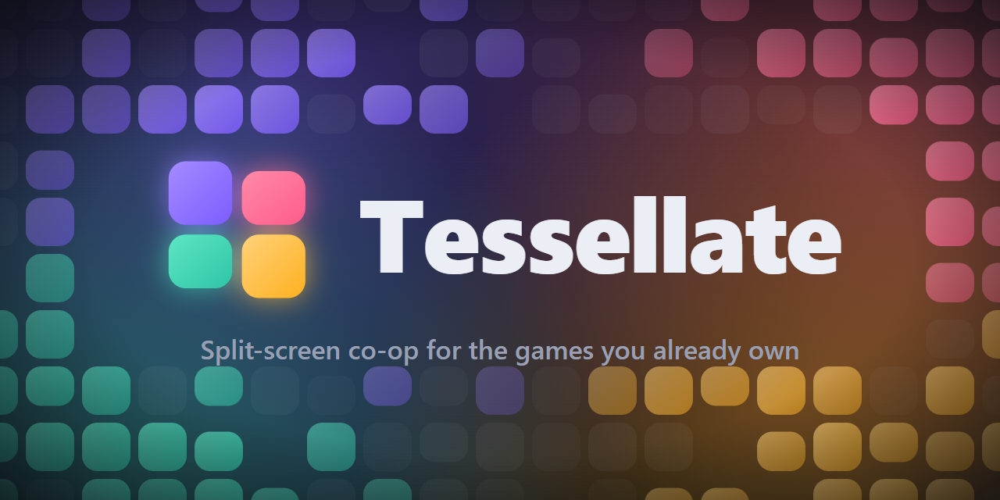

  

**Tessellate** is a free Windows app that turns PC games into couch co-op. It runs a copy of the game for each player, gives everyone their own controller, and tiles the windows across your screen. When you stop, everything goes back the way it was.

- 🎮 **Every player gets their own controller**, and their own saves where the game allows.
- 🪟 **Windows tile themselves** across one screen or several.
- 🛋️ **Couch mode** for the TV, driven entirely from a controller.
- 🧑‍🤝‍🧑 **Profiles and characters** that follow each player from game to game.
- 🛡️ **Your games stay untouched:** every change is temporary, and games with anti-cheat are blocked.

**[Website](https://tessellate.games)** · **[Try the demo in your browser](https://tessellate.games/demo/)** · **[Games and their status](https://tessellate.games/games)** · **[Roadmap](https://tessellate.games/roadmap)**

The first release and the source code (GPL-3.0) are on their way.
